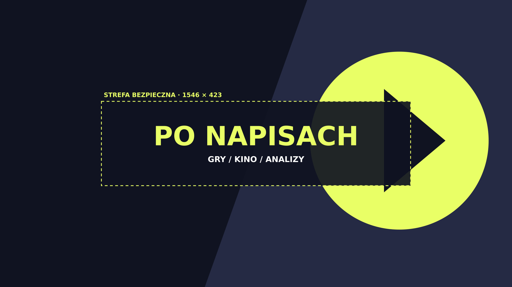

# Po napisach

Projekt koncepcyjny – marka fikcyjna

Oprawa fikcyjnego kanału YouTube o grach i kinie.

## Overview

A graphic package for video channel branding commissions. It includes a 2560 × 1440 banner with a marked 1546 × 423 center safe area, an 800 × 800 avatar, four 1280 × 720 thumbnail layouts, and a 1920 × 1080 end-screen template.

## Files and editing

- `source/` contains editable SVG templates. Open in Inkscape to change live text, colors, and shapes. Remove the safe-area guide from the final banner before upload.
- `exports/` contains PNG and PDF exports.
- `index.html` provides a responsive preview and download gallery.

## Technology

SVG, HTML, CSS, Inkscape and original vector artwork. Typography uses DejaVu Sans.
